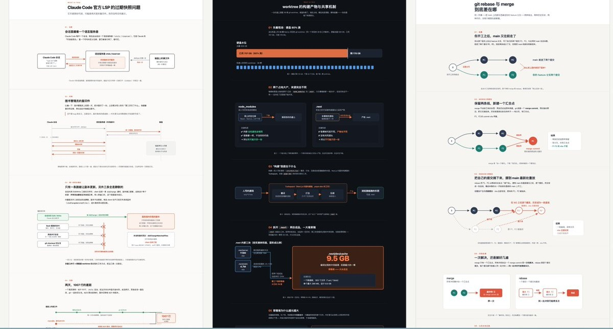

<p align="right">
  <a href="./README.md">中文</a> | <strong>English</strong>
</p>

# suyuan-skill

I'm Suyuan (X: [@suyuan1711](https://x.com/suyuan1711)), and I build agent products at an AI startup. These are the AI skills I use in my own work. Each one started with a specific problem I kept running into.

A skill is a manual written for your agent: once it's installed, the agent follows it whenever you bring up something it covers.

| When you… | Use |
|---|---|
| can't get your head around a concept, or your agent dumps screens of text you can't take in | [whatis](#whatis) |
| get AI output you can't fault, yet can't use either | [break-ai-slop](#break-ai-slop) |
| have too much on your plate and can't tell whether to take something on, or do it yourself | [task-triage](#task-triage) |
| want your Get Notes recordings and notes copied over to your own computer | [get-biji](#get-biji) |
| want a video, podcast, or recording on your phone turned into text | [get-biji](#get-biji) |

## Install

Install [Node.js](https://nodejs.org) first; the `npx` command below comes with it.

Everything (you'll get to pick which ones):

```bash
npx skills add suyuan2022/suyuan-skill -g
```

Just one, e.g. whatis:

```bash
npx skills add suyuan2022/suyuan-skill -g --skill whatis
```

`-g` installs to your user directory so every project can use it; without it, the skill goes into the current project only.

Or send this line to your agent and let it install the skill itself:

> Install this skill for me: https://github.com/suyuan2022/suyuan-skill/tree/main/whatis

Skip the ones you won't use. Your agent reads the description of every installed skill each time it starts, so extra skills just take up its attention.

---

<a id="whatis"></a>
### whatis: turn what you don't understand into pictures

When you hit an unfamiliar concept, or your agent spits out a wall of text you can't take in, call whatis. It builds an HTML page that's mostly big diagrams with very little text: flowcharts, sequence diagrams, architecture diagrams, before/after comparisons, whichever fits. If it doesn't have enough context, it goes through your files or searches the web first. Every box in a diagram has to be backed by something; nothing is made up.

```
/whatis why rate hikes make mortgages more expensive
```

<a href="./assets/whatis-demo.jpg"></a>

<sub>Three real outputs (click for full size): Claude Code's stale LSP snapshot problem, worktree build artifacts, and git rebase vs. merge.</sub>

Adapted from ELI5 (Explain Like I'm Five), shared by [@trq212](https://x.com/trq212) at Anthropic. The original is one line: "explain like I'm someone who knows nothing about this topic, using a HTML artifact with big pictures and few words". I added layout and information-hierarchy rules on top so the results come out more consistently.

<a id="break-ai-slop"></a>
### break-ai-slop: before doing anything, work out how a real pro would do it

AI output is often hard to fault, yet anyone could have written it. break-ai-slop makes the AI answer four questions before it starts:

1. In the real world, who does this best, and in what setting?
2. When a beginner or an AI gets it wrong, what does the result look like?
3. If every common mistake is avoided and it's still wrong, what's the root cause?
4. So what's the one constraint that actually decides success?

Only then does it get to work. I asked it to write an opening-day WeChat Moments post for a 20 m² bakery at the gate of an old residential compound in Hangzhou. Here's what it worked out before writing (translated from its Chinese output):

> Not "a copywriting expert", but someone who has run a small shop at a compound gate for a few years and won their first regulars through their own Moments posts.
>
> …Even with good writing, it can still fail, because the goal is wrong. This post isn't after likes; it needs people within a kilometre to actually walk in and buy something next Saturday, and then make it a habit. There's also a hidden constraint: a 20 m² shop can't hold many people, so the post should spread visits out.

How to call it: add "don't phone this in, think it through first" before your task, or type `/break-ai-slop`.

It's for work with no single right answer: writing, plans, judgment calls. For looking up a fact or fixing a typo, skip it; its output runs about twice as long.

<a id="task-triage"></a>
### task-triage: should you take this on, and should it be you?

With too much going on, the easy thing is to say yes to whatever comes next. Describe a task to task-triage and it scores it on five things, 0 to 3 each:

- Does it strengthen your position on the team?
- Does it have to be you?
- Will doing it once keep paying off?
- What happens if you don't do it?
- Will the right people see the result?

Then it looks at the tail cost: will this keep pulling at you after it's done? That's up to 3 points off. You get a total, a one-line reason, and a suggestion: 12 or more, do it yourself; 9 to 11, worth doing, but think about what to hand off; 6 to 8, hand it to someone else or to AI; 5 or under, seriously consider not doing it.

How to call it: "Help me decide whether this is worth doing: …"

<a id="get-biji"></a>
### get-biji: move your Get Notes onto your computer, and use its minutes for transcripts

Two things for [Get Notes](https://biji.com) users.

**Move all of Get Notes onto your computer.** Recordings, saved links, quick text notes: everything syncs to Markdown files on your machine, organised by date; when there's something new, run it again and it fills in the rest. Recording transcripts keep speakers and timestamps, and long ones get a file of their own. Once they're your own files, your agent can search them alongside your other notes, and they stay yours even if Get changes or you're offline.

**Use Get's transcription minutes for transcripts.** Drop in a Douyin, Xiaohongshu, Bilibili, or Xiaoyuzhou link and Get turns it into text for free; videos from other sites, or recordings on your phone, get uploaded for Get to transcribe, which counts against your monthly minutes by audio length. Your agent tells you roughly how many minutes it'll use first. Transcribing means creating a temporary note in Get; once the text is back, only that note is deleted and your other notes are left alone.

If you just want to save and search notes from a chat, Get's official [MCP](https://www.npmjs.com/package/@getnote/mcp) is enough, and it can search by meaning. get-biji covers the two things the official tools don't: moving everything onto your computer, and transcribing uploaded audio and video.

After installing, run `npm install && npx playwright install chromium` once in the skill folder (it downloads a ~250MB browser used only for login), or just ask your agent to. The first run opens a browser to log in to biji.com, so do it on your own computer; after that you won't need to log in again for about 90 days. Transcribing local audio and video also needs [ffmpeg](https://ffmpeg.org). Notes go to the folder you choose and the login lives in `~/.config/get-biji/`, so reinstalling or updating the skill loses nothing.

Built on [skychentian/GET-biji](https://github.com/skychentian/GET-biji) and included with the author's permission: the sync part is theirs, the transcript script is mine.

---

The mistakes I've made working with AI, and why these skills are written the way they are, are on X: [@suyuan1711](https://x.com/suyuan1711). If something doesn't work well, open an [issue](https://github.com/suyuan2022/suyuan-skill/issues).

## License

MIT.
